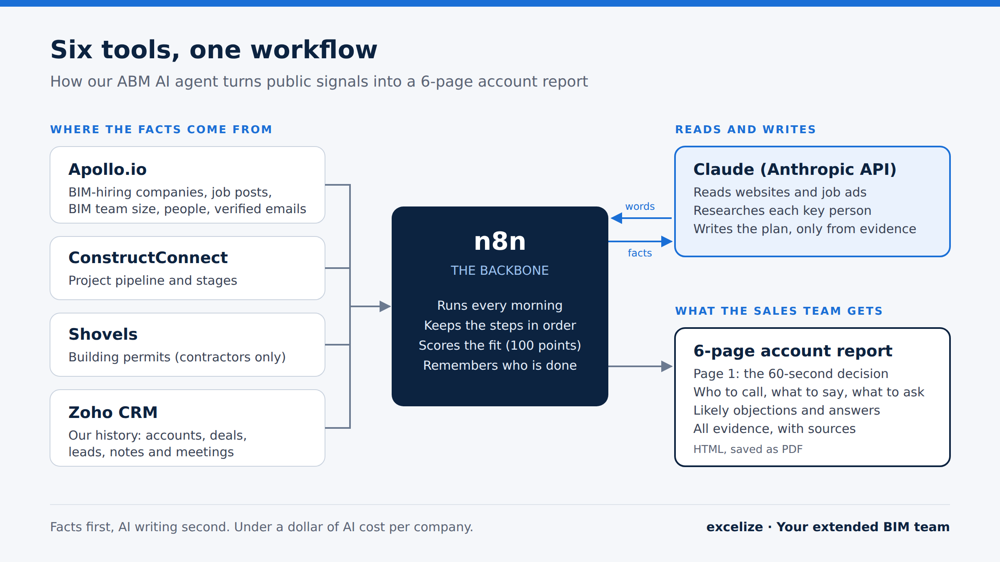
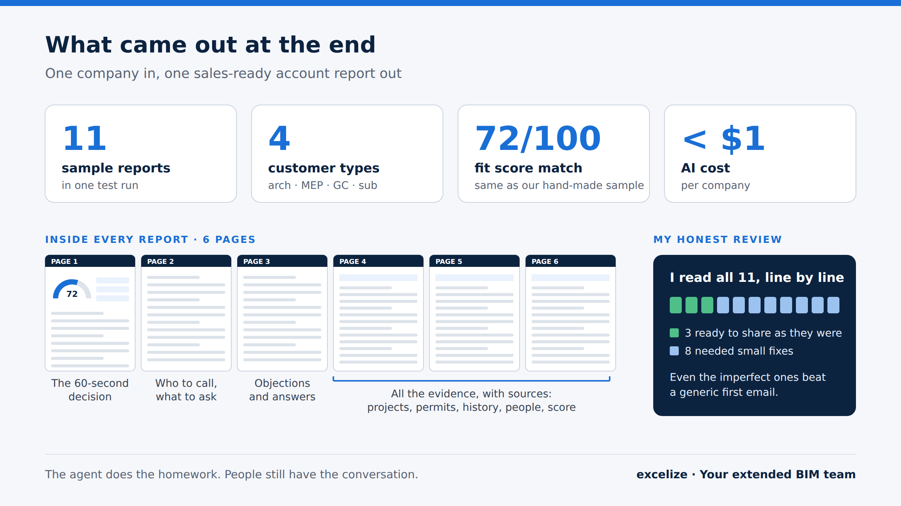

# ABM AI Agent for BIM sales

**Half a day of research. Now under a dollar.**

This is the n8n workflow we built at [Excelize](https://excelize.com) to prepare our sales team for every first conversation. Each morning it picks a few US AEC firms that are hiring for BIM, looks them up, and writes a 6-page **Account Intelligence Report**: who to call, what to say, what to ask, and which objections to expect. Every claim in the report comes with its evidence.

We're sharing it because we learned a lot building it, and we hope it saves someone else a few weeks.

## What it does

1. **Finds companies.** It looks for US AEC firms hiring for BIM, VDC or CAD roles (Apollo), skips any it has already processed, and stops at a daily limit.
2. **Qualifies them.** It reads each company's website and job ads, filters out competitors, and keeps only firms that fit the four customer types (architecture, MEP engineering, general contractor, subcontractor).
3. **Collects facts.** It gathers:
   - buying signals from hiring, team size, news and technology
   - the project pipeline (ConstructConnect)
   - building permits (Shovels, contractors only)
   - our own history with the account (Zoho CRM and Apollo sequences)
   - key people and verified contacts
4. **Scores the fit.** It gives a transparent score out of 100 across 8 factors. Each point has a plain reason, and missing data never counts as a pass.
5. **Writes the plan.** Claude writes pages 1–3 (bottom line, signals, stakeholders, conversation plan, discovery questions, objections) **only from the evidence collected above**. Names, emails and numbers always come from our own data, never from the model.
6. **Assembles the report.** It turns everything into a print-ready 6-page HTML report, which can be saved as PDF.

## The idea in one line

**Facts first, AI writing second.** The model never researches and writes in the same step. We collect evidence, score it with plain code, and only then ask the model to write. We also tell it plainly what it must not claim.

## What's in this repo

| Folder | What's inside |
|---|---|
| `nodes/` | The JavaScript for every n8n **Code** node, numbered in the order they run |
| `docs/how-it-works.md` | The full node-by-node flow, including the HTTP nodes between the Code nodes |
| `docs/setup.md` | Accounts, credentials and n8n settings you need |
| `workflow/` | Where the exported n8n workflow goes, plus how to clean it before sharing |
| `scripts/sanitize-workflow.py` | Strips credentials, pinned test data and IDs from an n8n export |

## Cost per company (our test runs)

| Item | Approx. cost |
|---|---|
| Claude (research + writing) | about $0.45–0.85 |
| Apollo | ~6 credits for verified emails |
| Shovels | up to 4 credits (contractors only) |
| ConstructConnect | covered by subscription |
| Zoho CRM, Apollo sequence reads | free |

## Status

This is a working build, not a finished product. Things still on the list:

- Saving each report into the CRM and assigning an owner by region
- Re-running a company automatically when a new project or BIM role appears
- PDF output inside the workflow
- Direct phone numbers (parked: n8n rounds Apollo's very long request IDs)
- Stronger checks on model-written sentences (it still sometimes over-claims)

## A few lessons

- Decide the output first. A clear report template was worth more than any tool choice.
- Read every output yourself. The bugs that matter don't throw errors. They are sentences that sound right and are wrong.
- Pin the paid nodes while testing. Our most expensive mistakes were clicks, not code.
- Keep a human in the loop. The agent does the homework. People still have the conversation.

## Adapting it

The scoring rules, customer types and prompts are tuned for a BIM services company selling to US AEC firms. To use it for your own business, start with:

- `nodes/8-fit-score.js` (scoring factors and weights)
- `nodes/4-cc-projects.js` (how the customer type is decided)
- `nodes/11-build-account-plan-prompt.js` (who you are and what you sell)

## License

MIT. See [LICENSE](LICENSE). Use it, change it, and if it helps you, we'd love to hear about it.

Built by Pratham (Head of RevOps & GTM, Excelize) with help from Claude.
